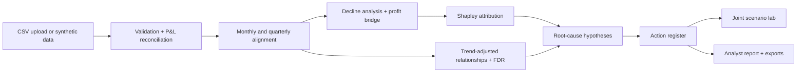

# NEXUS AI — Cross-Functional Profitability Intelligence
Connect the dots. Find the profit leak.

Profit has declined for three straight quarters while Marketing, HR, Operations and Finance each report satisfactory results. NEXUS AI integrates their data, reconciles the profit decline, attributes it fairly, tests cross-functional hypotheses and proposes corrective actions. Bundled data is **fictional synthetic data** with documented planted mechanisms (36 months, 12 quarters, 2 segments, actual and budget).

## How NEXUS AI works: the 10-step algorithm
1. **Ingest and map.** Load the four departmental tables (financials, marketing, HR, operations) plus optional KPI targets, or the synthetic demo. Map your column names to the schema and keep raw data unchanged.
2. **Validate and reconcile.** Check required fields, dates, negatives, duplicates, missing months and the P&L identities *gross profit = revenue − COGS* and *operating profit = gross profit − operating costs*. Problems are listed with row references; nothing is dropped or imputed silently.
3. **Align the grain.** Normalise everything to months, then to complete quarters. Amounts add; rates are order-weighted means; ratios such as discount, CAC and cost per order are recomputed from sums, never averaged.
4. **Establish the decline.** Compare the current quarter with the previous quarter, the same quarter last year, budget and a configurable baseline; separate absolute profit change from margin change; count consecutive declining quarters.
5. **Reconcile the profit bridge.** Decompose the profit change exactly into volume, list price, discounting, unit cost and mix, marketing, payroll, overtime, recruitment, operations and other costs, and verify it equals the actual change within a stated tolerance.
6. **Attribute fairly.** Compute exact Shapley values over eight drivers so interactions (such as volume times price) are shared, and compare them with the order-dependent sequential bridge. Each cost or revenue effect is counted once.
7. **Screen cross-functional relationships.** Remove trend and calendar-month effects, align by month and segment, test lags 0–2 with Pearson and Spearman, control false discoveries (Benjamini–Hochberg), flag multicollinearity, and run a chronological Ridge check against a naive baseline. Association only.
8. **Test root-cause hypotheses.** Score seven cross-department hypotheses by their bridge amount plus statistical evidence, list alternative explanations and the next validation step, and show the departmental-KPI paradox (departments on target while profit falls).
9. **Prioritise corrective actions.** Rank actions by impact, evidence strength and effort, with owners, risks, success metrics and review period. The score is a ranking aid, not a probability of success.
10. **Stress-test, report and review.** Run base, downside and upside scenarios in one joint model (interactions included, double counting shown), generate the evidence-linked investigation report, export CSV and Markdown, and require human review before acting.

## Architecture


## Run
```
pip install -r requirements.txt
python app.py
```
In Google Colab paste `app.py` into one cell and run it. The `src/` modules in the brief are consolidated into `app.py`.

## Sample schemas
`financials.csv` (period, segment, revenue, cogs, marketing_expense, payroll, overtime_cost, recruit_train_cost, ops_cost, other_opex, gross_profit, operating_profit, budget_* columns); `marketing.csv` (period, segment, gross_sales, new_customers, conversion_rate, low_margin_mix_share, email_ctr); `hr.csv` (period, segment, headcount, overtime_hours, turnover_rate, absence_rate, engagement_score); `operations.csv` (period, segment, orders, capacity_util, rework_rate, return_rate, on_time_pct); `departmental_kpis.csv` (kpi, department, column, target, direction).

## Tests and limits
`pip install pytest && pytest tests` runs the built-in self-tests. Associations are not causes; scenarios are hypothetical; actions need human review. Add screenshots to `screenshots/` (none included).
